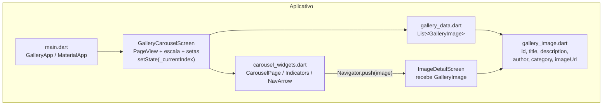
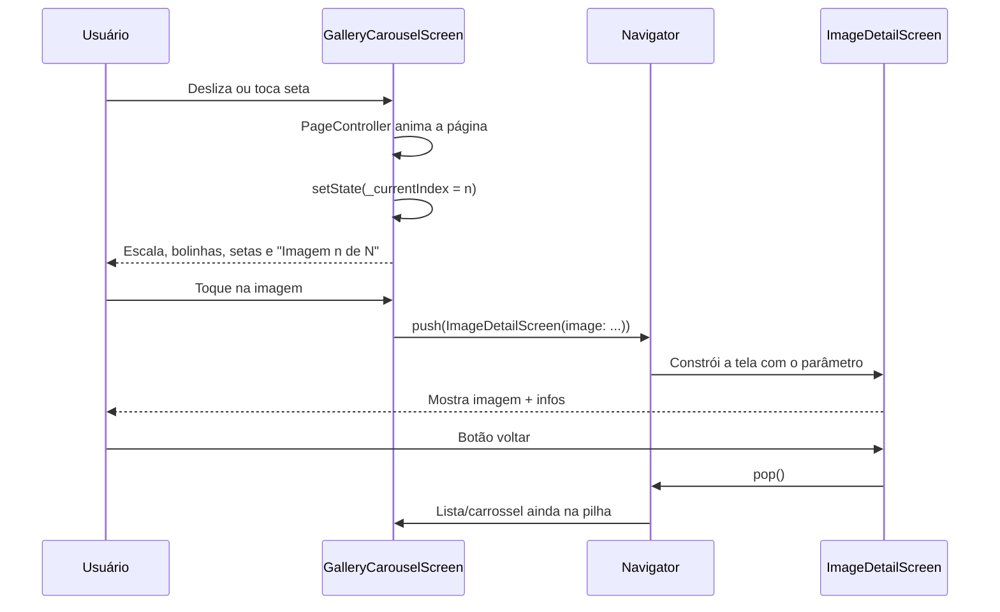

# Desafio 1 — Galeria inteligente de imagens

Este documento é um guia educativo completo do desafio de carrossel (PDM2).
Ao final, você deve conseguir:

1. entender o enunciado e o que cada requisito treina;
2. **recriar** o app do zero (modelo, lista mockada, carrossel, detalhe);
3. explicar **navegação**, **listas**, **imagens**, **carrossel**, **passagem de parâmetros** e **estado básico**;
4. saber usar imagens da **web** e também como faria com **assets** locais;
5. desenhar o **diagrama de arquitetura** pedido na entrega.

---

## O que o PDF pede

Desenvolver um app que:

- mostre uma coleção de imagens em **carrossel**;
- permita **navegar** entre as imagens e **identificar** qual está sendo exibida;
- ao **selecionar** uma imagem, abra uma **segunda tela** com a imagem e informações associadas.

Temas trabalhados: recuperação de PDM I, navegação, listas, imagens, carrossel,
passagem de parâmetros, gerenciamento básico de estado e organização do projeto.

Entrega sugerida pelo PDF: código, diagrama simples da arquitetura e vídeo de até 2 minutos.

---

## Como rodar

```bash
cd desafio_1_carrossel
flutter pub get
flutter run
```

Fluxo de teste:

1. Observe que a imagem **central** está maior que as laterais.
2. Na primeira imagem, só existe seta para a **direita**; nas intermediárias, as duas; na última, só a da **esquerda**.
3. Navegue com swipe ou com as setas e acompanhe `Imagem X de Y` + bolinhas.
4. Toque na imagem central para abrir o detalhe.
5. Volte com o botão do `AppBar` (`Navigator.pop`).

---

## Diagrama simples da arquitetura

O diagrama abaixo é um **mapa estático** do app: mostra **quais peças existem** e
**quem depende de quem**. Não descreve o tempo (o “quando”); só a estrutura.



### Como ler o diagrama de arquitetura

Pense nele de cima para baixo, seguindo as setas:

1. **`Main` (`main.dart`)**  
   Ponto de entrada. Cria o `MaterialApp` (tema + `Navigator`) e define a tela
   inicial como o carrossel. Sem o `Main`, nada sobe na tela.

2. **`Carousel` (`GalleryCarouselScreen`)**  
   Tela 1. Orquestra o `PageView`, o índice atual (`_currentIndex`), a escala e
   as setas. É o “cérebro” da interação na galeria.

3. **`Data` (`gallery_data.dart`) → `Model` (`gallery_image.dart`)**  
   A lista mockada (`galleryImages`) é feita de objetos `GalleryImage`. O modelo
   define *o formato* dos dados; a pasta `data` guarda *os valores* usados no app.

4. **`Carousel` → `Data`**  
   A tela do carrossel lê a lista para saber quantas páginas existem e qual
   imagem mostrar em cada índice.

5. **`Carousel` → `Widgets`**  
   A tela não desenha tudo sozinha: delega card, bolinhas e setas para
   `carousel_widgets.dart`. Isso mantém a tela mais limpa e os widgets reutilizáveis.

6. **`Widgets` → `Detail` (via `Navigator.push`)**  
   Quando o usuário toca no card, o widget de página abre a segunda tela e
   **passa o objeto** `GalleryImage` como parâmetro.

7. **`Detail` → `Model`**  
   A tela de detalhe não busca a imagem de novo na lista: ela só usa o
   `GalleryImage` que recebeu (título, URL, descrição, etc.).

Resumo: o diagrama de arquitetura responde *“como o código está organizado e
conectado?”*. As setas são dependências/uso, não passos no tempo.

---

## Diagrama de sequência (fluxo de navegação)

O diagrama abaixo é **dinâmico**: mostra **o que acontece ao longo do tempo**
quando o usuário interage. Cada setinha é uma mensagem/ação entre participantes.



### Como ler o diagrama de sequência

Os participantes (colunas) são:

| Participante | Papel |
|--------------|--------|
| **Usuário (U)** | Quem desliza, toca seta, abre detalhe e volta |
| **GalleryCarouselScreen (C)** | Tela do carrossel (estado + UI) |
| **Navigator (N)** | Pilha de rotas do Flutter (`push` / `pop`) |
| **ImageDetailScreen (D)** | Segunda tela, só com o item selecionado |

Leitura linha a linha (de cima para baixo = ordem no tempo):

1. **`U → C`: desliza ou toca seta**  
   O usuário muda de imagem (gesto ou botão).

2. **`C → C`: `PageController` anima a página**  
   A própria tela pede ao controller para ir à página anterior/próxima (ou
   acompanha o swipe). A seta “para si mesma” significa lógica interna.

3. **`C → C`: `setState(_currentIndex = n)`**  
   O índice muda; o Flutter reconstrói o que depende desse estado.

4. **`C -->> U`: atualiza a interface**  
   A seta tracejada é a **resposta visual**: escala da imagem central, bolinhas,
   quais setas aparecem e o texto “Imagem n de N”.

5. **`U → C`: toque na imagem**  
   O usuário escolhe ver o detalhe da imagem atual (ou da página tocada).

6. **`C → N`: `push(ImageDetailScreen(image: ...))`**  
   A tela não “troca de arquivo” sozinha: pede ao `Navigator` para **empilhar**
   a rota do detalhe, passando o `GalleryImage` no construtor.

7. **`N → D`: constrói a tela com o parâmetro**  
   O `Navigator` instancia/monta `ImageDetailScreen` com o objeto recebido.

8. **`D -->> U`: mostra imagem + infos**  
   O usuário vê título, categoria, autor, descrição, etc.

9. **`U → D`: botão voltar**  
   O usuário pede para sair do detalhe.

10. **`D → N`: `pop()`**  
    A rota do detalhe é removida do topo da pilha.

11. **`N → C`: carrossel ainda na pilha**  
    Como usamos `push`/`pop` (e não `pushReplacement`), a tela do carrossel
    **não foi destruída**: índice, escala e posição voltam como estavam.

Resumo: o diagrama de sequência responde *“o que acontece, em que ordem, quando
o usuário usa o app?”*. Use-o junto com o de arquitetura: um mostra a estrutura;
o outro, o comportamento.

### Diferença rápida entre os dois diagramas

| | Arquitetura (flowchart) | Sequência |
|--|-------------------------|-----------|
| Foco | Estrutura / pastas / dependências | Tempo / interação |
| Pergunta | O que existe e quem usa quem? | O que acontece passo a passo? |
| Setas | Dependência de código | Mensagens e chamadas |
| Exemplo | `Carousel` usa `Data` e `Widgets` | Usuário toca → `push` → detalhe → `pop` |

---

Organização das pastas:

```text
desafio_1_carrossel/lib/
├── main.dart
├── models/
│   └── gallery_image.dart      # modelo (dados de uma imagem)
├── data/
│   └── gallery_data.dart       # lista mockada (fonte de dados)
├── screens/
│   ├── gallery_carousel_screen.dart  # tela 1: carrossel
│   └── image_detail_screen.dart      # tela 2: detalhe
└── widgets/
    └── carousel_widgets.dart   # peças reutilizáveis do carrossel
```

Essa separação é a “organização do projeto” pedida no enunciado: modelo, dados,
telas e widgets em pastas claras.

---

## Passo a passo para recriar do zero

### 1. Modelo — o que é uma imagem da galeria?

```dart
// lib/models/gallery_image.dart
class GalleryImage {
  final int id;
  final String title;
  final String description;
  final String author;
  final String category;
  final String imageUrl;

  const GalleryImage({
    required this.id,
    required this.title,
    required this.description,
    required this.author,
    required this.category,
    required this.imageUrl,
  });
}
```

Cada campo alimenta a UI:

| Campo | Uso na interface |
|-------|------------------|
| `title` | Título no carrossel e no detalhe |
| `category` / `author` | Chips na tela de detalhe |
| `description` | Texto longo do detalhe |
| `imageUrl` | Fonte da foto (`Image.network`) |
| `id` | Identificador exibido e útil para depurar |

### 2. Lista mockada — “listas” no sentido do desafio

Não precisamos de API real. Uma `List<GalleryImage>` constante basta:

```dart
const List<GalleryImage> galleryImages = [
  GalleryImage(
    id: 1,
    title: 'Floresta ao amanhecer',
    description: '...',
    author: 'Ana Souza',
    category: 'Natureza',
    imageUrl: 'https://picsum.photos/id/1015/1200/800',
  ),
  // ... demais itens
];
```

Essa lista é a coleção que o carrossel percorre (`itemCount` / `itemBuilder`).

### 3. `main.dart` — ponto de entrada

```dart
void main() {
  runApp(const GalleryApp());
}

class GalleryApp extends StatelessWidget {
  const GalleryApp({super.key});

  @override
  Widget build(BuildContext context) {
    return MaterialApp(
      title: 'Galeria Inteligente',
      theme: ThemeData(
        useMaterial3: true,
        colorScheme: ColorScheme.fromSeed(seedColor: Colors.teal),
      ),
      home: const GalleryCarouselScreen(),
    );
  }
}
```

O `MaterialApp` cria o `Navigator` raiz. Sem ele, `Navigator.push` não funciona.

### 4. Carrossel com `PageView` — listas + carrossel + estado

O carrossel é um `PageView.builder` (lista horizontal paginada), envolvido por
um `Stack` (para as setas). Cada página usa um `AnimatedBuilder` (para a escala):

```dart
PageView.builder(
  controller: _pageController,
  itemCount: galleryImages.length,
  onPageChanged: (index) {
    setState(() => _currentIndex = index);
  },
  itemBuilder: (context, index) {
    return AnimatedBuilder(
      animation: _pageController,
      builder: (context, child) {
        return CarouselPage(
          image: galleryImages[index],
          scale: _scaleForIndex(index),
        );
      },
    );
  },
);
```

Pontos importantes:

- **Lista:** `itemBuilder` monta um widget por índice, sob demanda.
- **Carrossel:** o usuário desliza página a página (`viewportFraction: 0.78` deixa as vizinhas visíveis).
- **Identificar a imagem atual:** texto `Imagem ${_currentIndex + 1} de $total` + bolinhas + escala maior.
- **Estado básico:** `_currentIndex` vive no `State` e muda com `setState` em `onPageChanged`.

Não esqueça o ciclo de vida do controller:

```dart
late final PageController _pageController;

@override
void initState() {
  super.initState();
  _pageController = PageController(viewportFraction: 0.78);
}

@override
void dispose() {
  _pageController.dispose();
  super.dispose();
}
```

### 5. Efeito de escala — imagem central maior que as laterais

A ideia: quanto mais perto a página estiver do centro do `PageView`, maior ela fica.

1. O `PageController` expõe `page` (posição contínua, ex.: `2.3` no meio de um swipe).
2. Para cada índice, calculamos a **distância** até essa página.
3. Convertemos distância em escala (1.0 no centro, ~0.86 nas laterais).
4. Aplicamos com `Transform.scale` dentro de `CarouselPage`.

```dart
double _scaleForIndex(int index) {
  if (!_pageController.hasClients ||
      !_pageController.position.haveDimensions) {
    return index == _currentIndex ? 1.0 : 0.86;
  }

  final page = _pageController.page ?? _currentIndex.toDouble();
  final distance = (page - index).abs();
  return (1.0 - (distance * 0.14)).clamp(0.86, 1.0);
}
```

Por que `AnimatedBuilder(animation: _pageController)` em **cada** página?

- O `onPageChanged` só dispara **depois** da página assentar.
- Durante o gesto, precisamos redesenhar a escala a cada frame.
- Colocar o `AnimatedBuilder` **dentro** do `itemBuilder` atualiza só os cards, sem recriar o `PageView` inteiro.
- O `PageController` notifica ouvintes enquanto `page` muda; a escala acompanha o swipe suavemente.

No card:

```dart
Transform.scale(
  scale: scale,
  child: /* InkWell + Image.network ... */,
);
```

Dica: combine escala com `viewportFraction < 1.0` para as laterais aparecerem “encolhidas” ao lado da imagem ativa.

### 6. Setas de navegação — cantos, altura média, condicionais

As setas ficam **no meio da altura** da área do carrossel e nos **cantos** (esquerda/direita), usando um `Stack` por cima do `PageView`:

```dart
Stack(
  alignment: Alignment.center,
  children: [
    /* PageView + AnimatedBuilder */,
    if (_currentIndex > 0)
      Positioned(
        left: 4.0,
        child: CarouselNavArrow(
          icon: Icons.chevron_left,
          onPressed: _goToPrevious,
        ),
      ),
    if (_currentIndex < total - 1)
      Positioned(
        right: 4.0,
        child: CarouselNavArrow(
          icon: Icons.chevron_right,
          onPressed: _goToNext,
        ),
      ),
  ],
);
```

Regras de visibilidade:

| Posição | Seta esquerda | Seta direita |
|---------|---------------|--------------|
| Primeira (`index == 0`) | oculta | visível |
| Meio | visível | visível |
| Última (`index == length - 1`) | visível | oculta |

A navegação por botão usa a API do controller (com animação):

```dart
await _pageController.previousPage(
  duration: const Duration(milliseconds: 320),
  curve: Curves.easeOutCubic,
);

await _pageController.nextPage(
  duration: const Duration(milliseconds: 320),
  curve: Curves.easeOutCubic,
);
```

O widget `CarouselNavArrow` é um `IconButton` circular semi-transparente, para contrastar com qualquer foto.

Importante: o toque na seta **não** deve abrir o detalhe — por isso as setas estão no `Stack` da tela, fora do `InkWell` do card.

### 7. Indicadores (bolinhas)

`List.generate` cria um indicador por imagem. A bolinha ativa fica mais larga e com a cor primária do tema. Isso reforça visualmente “qual imagem está sendo exibida”.

### 8. Imagens da web — `Image.network`

Neste projeto usamos fotos remotas:

```dart
Image.network(
  image.imageUrl,
  fit: BoxFit.cover,
  loadingBuilder: (context, child, progress) {
    if (progress == null) return child;
    return const Center(child: CircularProgressIndicator());
  },
  errorBuilder: (context, error, stackTrace) {
    return const Center(child: Icon(Icons.broken_image_outlined));
  },
);
```

Permissões necessárias:

- **Android:** `INTERNET` no `AndroidManifest.xml`.
- **macOS:** `com.apple.security.network.client` nos entitlements.

Sem isso, a imagem falha em runtime mesmo com URL correta.

### 9. Passagem de parâmetros e navegação

Ao tocar no card:

```dart
Navigator.push(
  context,
  MaterialPageRoute(
    builder: (context) => ImageDetailScreen(image: image),
  ),
);
```

O parâmetro é o objeto `GalleryImage` inteiro, passado no construtor da segunda tela:

```dart
class ImageDetailScreen extends StatelessWidget {
  final GalleryImage image;

  const ImageDetailScreen({super.key, required this.image});
  // ...
}
```

Isso é passagem de parâmetros tipada (sem mapa solto de `arguments`). A tela de detalhe é `StatelessWidget` porque só exibe o que recebeu.

Voltar: o `AppBar` adiciona o botão automaticamente e chama `Navigator.pop`.

### 10. Tela de detalhe

Mostre:

- a mesma imagem em tamanho maior;
- título;
- chips de categoria e autor;
- descrição;
- metadados (id e URL).

Use `SingleChildScrollView` para caber em telas menores.

---

## Gerenciamento básico de estado (o que importa aqui)

Neste desafio, “estado” é principalmente:

| Estado | Onde vive | Por que existe |
|--------|-----------|----------------|
| `_currentIndex` | `GalleryCarouselScreen` | Texto, bolinhas e visibilidade das setas |
| `PageController` / `page` | idem | Escala contínua durante o swipe + `nextPage`/`previousPage` |
| `image` selecionada | argumento da rota de detalhe | Levar dados para a segunda tela |

Não há Provider/Riverpod: `setState` basta. Quando o índice muda, o Flutter reconstrói o título, o subtítulo e as bolinhas.

A lista mockada é imutável (`const`). O estado **mutável** é só a interação do usuário (página atual).

---

## Imagens via assets (como seria feito)

A implementação atual usa a **web**. Em produção ou offline, o caminho clássico é **assets**.

### Passo 1 — pastas e arquivos

```text
desafio_1_carrossel/
└── assets/
    └── images/
        ├── floresta.jpg
        ├── cidade.jpg
        └── montanhas.jpg
```

### Passo 2 — declarar no `pubspec.yaml`

```yaml
flutter:
  uses-material-design: true
  assets:
    - assets/images/
```

Ou arquivo a arquivo:

```yaml
  assets:
    - assets/images/floresta.jpg
    - assets/images/cidade.jpg
```

Depois rode `flutter pub get`.

### Passo 3 — ajustar o modelo / dados

Em vez de URL HTTP:

```dart
GalleryImage(
  id: 1,
  title: 'Floresta ao amanhecer',
  description: '...',
  author: 'Ana Souza',
  category: 'Natureza',
  imageUrl: 'assets/images/floresta.jpg', // caminho do asset
),
```

### Passo 4 — trocar o widget de imagem

```dart
// Web (este projeto)
Image.network(image.imageUrl, fit: BoxFit.cover);

// Assets (alternativa)
Image.asset(image.imageUrl, fit: BoxFit.cover);
```

### Comparação rápida

| Critério | `Image.network` | `Image.asset` |
|----------|-----------------|---------------|
| Precisa de internet | Sim | Não |
| Tamanho do APK/IPA | Menor | Maior (fotos embutidas) |
| Permissões extras | Internet / network client | Não |
| Ideal para | demos, conteúdo remoto | offline, branding fixo |
| Loading / erro | `loadingBuilder` / `errorBuilder` | falha se o asset não existir |

Dá para unificar as duas abordagens com um campo `bool isRemote` ou um getter que escolhe `Image.network` vs `Image.asset`. Neste desafio mantivemos só a web para simplificar a entrega e evitar versionar binários grandes.

---

## Mapa do código (arquivo por arquivo)

### `lib/main.dart`

Sobe o `GalleryApp`, define tema Material 3 e aponta `home` para o carrossel.

### `lib/models/gallery_image.dart`

Classe imutável com os campos da imagem.

### `lib/data/gallery_data.dart`

Lista constante de 8 imagens (picsum com IDs fixos).

### `lib/screens/gallery_carousel_screen.dart`

Tela 1: `PageController`, `_currentIndex`, escala via `_scaleForIndex`,
`PageView` + `AnimatedBuilder`, setas condicionais, texto “Imagem X de Y”
e indicadores.

### `lib/widgets/carousel_widgets.dart`

- `CarouselIndicators`: bolinhas.
- `CarouselNavArrow`: seta circular nos cantos.
- `CarouselPage`: card com `Transform.scale`, imagem, gradiente, título e `Navigator.push`.

### `lib/screens/image_detail_screen.dart`

Tela 2: recebe `GalleryImage` e monta o layout de detalhe.

---

## Checklist alinhado ao enunciado

| Requisito do PDF | Como foi atendido |
|------------------|-------------------|
| Carrossel de imagens | `PageView.builder` + escala + setas |
| Navegar entre imagens | swipe e `previousPage` / `nextPage` |
| Identificar a imagem atual | texto + bolinhas + escala maior + setas condicionais |
| Segunda tela com imagem e infos | `ImageDetailScreen` |
| Navegação | `Navigator.push` / `pop` |
| Listas | `galleryImages` + `itemBuilder` |
| Imagens | `Image.network` (+ seção de assets neste doc) |
| Passagem de parâmetros | `ImageDetailScreen(image: image)` |
| Estado básico | `setState` no índice do carrossel |
| Organização | pastas `models`, `data`, `screens`, `widgets` |
| Diagrama | Mermaid neste documento |

---

## Roteiro sugerido para o vídeo (até 2 min)

1. **0:00–0:20** — Mostrar a estrutura de pastas e o diagrama.
2. **0:20–0:50** — Rodar o app: mostrar escala central, setas e contador/bolinhas.
3. **0:50–1:20** — Abrir o detalhe e citar a passagem do objeto `GalleryImage`.
4. **1:20–1:45** — Abrir o código do `_scaleForIndex`, das setas e do `Navigator.push`.
5. **1:45–2:00** — Mencionar que as imagens vêm da web e que o doc explica a versão com assets.

---

## Comandos úteis

```bash
cd desafio_1_carrossel
flutter pub get
flutter analyze
flutter test
flutter run
```
