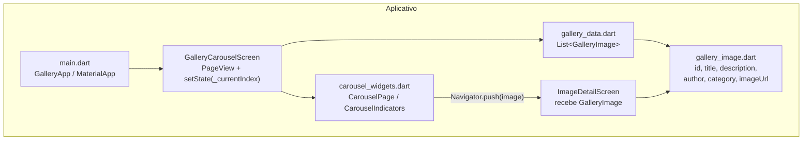
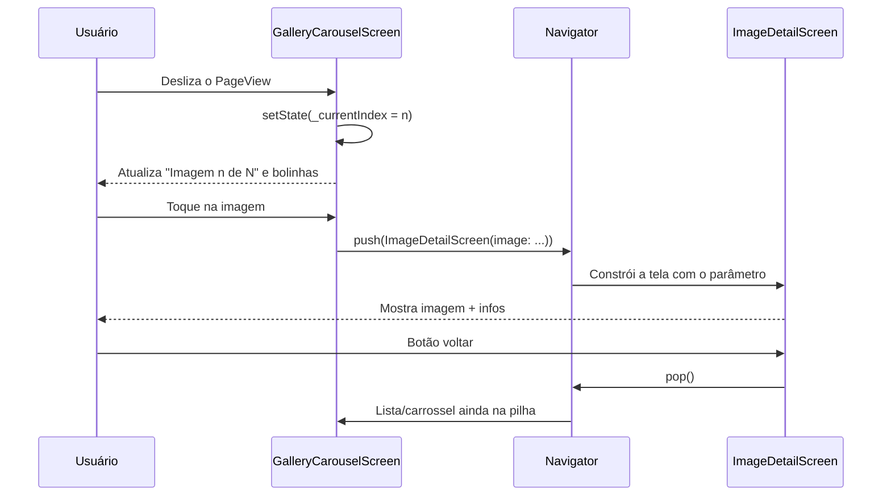

# Desafio 1 — Galeria inteligente de imagens

Este documento é um guia educativo completo do desafio de carrossel (PDM2).
Ao final, você deve conseguir:

1. entender o enunciado e o que cada requisito treina;
2. **recriar** o app do zero (modelo, lista mockada, carrossel, detalhe);
3. explicar **navegação**, **listas**, **imagens**, **carrossel**, **passagem de parâmetros** e **estado básico**;
4. saber usar imagens da **web** e também como faria com **assets** locais;
5. desenhar o **diagrama de arquitetura** pedido na entrega.

---

## O que o PDF pede

Desenvolver um app que:

- mostre uma coleção de imagens em **carrossel**;
- permita **navegar** entre as imagens e **identificar** qual está sendo exibida;
- ao **selecionar** uma imagem, abra uma **segunda tela** com a imagem e informações associadas.

Temas trabalhados: recuperação de PDM I, navegação, listas, imagens, carrossel,
passagem de parâmetros, gerenciamento básico de estado e organização do projeto.

Entrega sugerida pelo PDF: código, diagrama simples da arquitetura e vídeo de até 2 minutos.

---

## Como rodar

```bash
cd desafio_1_carrossel
flutter pub get
flutter run
```

Fluxo de teste:

1. Deslize o carrossel e observe o texto `Imagem X de Y` e as bolinhas.
2. Toque em uma imagem.
3. Veja título, categoria, autor e descrição na tela de detalhe.
4. Volte com o botão do `AppBar` (`Navigator.pop`).

---

## Diagrama simples da arquitetura



Fluxo de navegação:



Organização das pastas:

```text
desafio_1_carrossel/lib/
├── main.dart
├── models/
│   └── gallery_image.dart      # modelo (dados de uma imagem)
├── data/
│   └── gallery_data.dart       # lista mockada (fonte de dados)
├── screens/
│   ├── gallery_carousel_screen.dart  # tela 1: carrossel
│   └── image_detail_screen.dart      # tela 2: detalhe
└── widgets/
    └── carousel_widgets.dart   # peças reutilizáveis do carrossel
```

Essa separação é a “organização do projeto” pedida no enunciado: modelo, dados,
telas e widgets em pastas claras.

---

## Passo a passo para recriar do zero

### 1. Modelo — o que é uma imagem da galeria?

```dart
// lib/models/gallery_image.dart
class GalleryImage {
  final int id;
  final String title;
  final String description;
  final String author;
  final String category;
  final String imageUrl;

  const GalleryImage({
    required this.id,
    required this.title,
    required this.description,
    required this.author,
    required this.category,
    required this.imageUrl,
  });
}
```

Cada campo alimenta a UI:

| Campo | Uso na interface |
|-------|------------------|
| `title` | Título no carrossel e no detalhe |
| `category` / `author` | Chips na tela de detalhe |
| `description` | Texto longo do detalhe |
| `imageUrl` | Fonte da foto (`Image.network`) |
| `id` | Identificador exibido e útil para depurar |

### 2. Lista mockada — “listas” no sentido do desafio

Não precisamos de API real. Uma `List<GalleryImage>` constante basta:

```dart
const List<GalleryImage> galleryImages = [
  GalleryImage(
    id: 1,
    title: 'Floresta ao amanhecer',
    description: '...',
    author: 'Ana Souza',
    category: 'Natureza',
    imageUrl: 'https://picsum.photos/id/1015/1200/800',
  ),
  // ... demais itens
];
```

Essa lista é a coleção que o carrossel percorre (`itemCount` / `itemBuilder`).

### 3. `main.dart` — ponto de entrada

```dart
void main() {
  runApp(const GalleryApp());
}

class GalleryApp extends StatelessWidget {
  const GalleryApp({super.key});

  @override
  Widget build(BuildContext context) {
    return MaterialApp(
      title: 'Galeria Inteligente',
      theme: ThemeData(
        useMaterial3: true,
        colorScheme: ColorScheme.fromSeed(seedColor: Colors.teal),
      ),
      home: const GalleryCarouselScreen(),
    );
  }
}
```

O `MaterialApp` cria o `Navigator` raiz. Sem ele, `Navigator.push` não funciona.

### 4. Carrossel com `PageView` — listas + carrossel + estado

O carrossel é um `PageView.builder` (lista horizontal paginada):

```dart
PageView.builder(
  controller: _pageController,
  itemCount: galleryImages.length,
  onPageChanged: (index) {
    setState(() {
      _currentIndex = index;
    });
  },
  itemBuilder: (context, index) {
    return CarouselPage(image: galleryImages[index]);
  },
);
```

Pontos importantes:

- **Lista:** `itemBuilder` monta um widget por índice, sob demanda.
- **Carrossel:** o usuário desliza página a página (`viewportFraction: 0.88` mostra um pedaço da vizinha).
- **Identificar a imagem atual:** texto `Imagem ${_currentIndex + 1} de $total` + bolinhas.
- **Estado básico:** `_currentIndex` vive no `State` e muda com `setState` em `onPageChanged`.

Não esqueça o ciclo de vida do controller:

```dart
late final PageController _pageController;

@override
void initState() {
  super.initState();
  _pageController = PageController(viewportFraction: 0.88);
}

@override
void dispose() {
  _pageController.dispose();
  super.dispose();
}
```

### 5. Indicadores (bolinhas)

`List.generate` cria um indicador por imagem. A bolinha ativa fica mais larga e com a cor primária do tema. Isso reforça visualmente “qual imagem está sendo exibida”.

### 6. Imagens da web — `Image.network`

Neste projeto usamos fotos remotas:

```dart
Image.network(
  image.imageUrl,
  fit: BoxFit.cover,
  loadingBuilder: (context, child, progress) {
    if (progress == null) return child;
    return const Center(child: CircularProgressIndicator());
  },
  errorBuilder: (context, error, stackTrace) {
    return const Center(child: Icon(Icons.broken_image_outlined));
  },
);
```

Permissões necessárias:

- **Android:** `INTERNET` no `AndroidManifest.xml`.
- **macOS:** `com.apple.security.network.client` nos entitlements.

Sem isso, a imagem falha em runtime mesmo com URL correta.

### 7. Passagem de parâmetros e navegação

Ao tocar no card:

```dart
Navigator.push(
  context,
  MaterialPageRoute(
    builder: (context) => ImageDetailScreen(image: image),
  ),
);
```

O parâmetro é o objeto `GalleryImage` inteiro, passado no construtor da segunda tela:

```dart
class ImageDetailScreen extends StatelessWidget {
  final GalleryImage image;

  const ImageDetailScreen({super.key, required this.image});
  // ...
}
```

Isso é passagem de parâmetros tipada (sem mapa solto de `arguments`). A tela de detalhe é `StatelessWidget` porque só exibe o que recebeu.

Voltar: o `AppBar` adiciona o botão automaticamente e chama `Navigator.pop`.

### 8. Tela de detalhe

Mostre:

- a mesma imagem em tamanho maior;
- título;
- chips de categoria e autor;
- descrição;
- metadados (id e URL).

Use `SingleChildScrollView` para caber em telas menores.

---

## Gerenciamento básico de estado (o que importa aqui)

Neste desafio, “estado” é principalmente:

| Estado | Onde vive | Por que existe |
|--------|-----------|----------------|
| `_currentIndex` | `GalleryCarouselScreen` | Saber qual página do carrossel está ativa |
| `PageController` | idem | Controlar o `PageView` |
| `image` selecionada | argumento da rota de detalhe | Levar dados para a segunda tela |

Não há Provider/Riverpod: `setState` basta. Quando o índice muda, o Flutter reconstrói o título, o subtítulo e as bolinhas.

A lista mockada é imutável (`const`). O estado **mutável** é só a interação do usuário (página atual).

---

## Imagens via assets (como seria feito)

A implementação atual usa a **web**. Em produção ou offline, o caminho clássico é **assets**.

### Passo 1 — pastas e arquivos

```text
desafio_1_carrossel/
└── assets/
    └── images/
        ├── floresta.jpg
        ├── cidade.jpg
        └── montanhas.jpg
```

### Passo 2 — declarar no `pubspec.yaml`

```yaml
flutter:
  uses-material-design: true
  assets:
    - assets/images/
```

Ou arquivo a arquivo:

```yaml
  assets:
    - assets/images/floresta.jpg
    - assets/images/cidade.jpg
```

Depois rode `flutter pub get`.

### Passo 3 — ajustar o modelo / dados

Em vez de URL HTTP:

```dart
GalleryImage(
  id: 1,
  title: 'Floresta ao amanhecer',
  description: '...',
  author: 'Ana Souza',
  category: 'Natureza',
  imageUrl: 'assets/images/floresta.jpg', // caminho do asset
),
```

### Passo 4 — trocar o widget de imagem

```dart
// Web (este projeto)
Image.network(image.imageUrl, fit: BoxFit.cover);

// Assets (alternativa)
Image.asset(image.imageUrl, fit: BoxFit.cover);
```

### Comparação rápida

| Critério | `Image.network` | `Image.asset` |
|----------|-----------------|---------------|
| Precisa de internet | Sim | Não |
| Tamanho do APK/IPA | Menor | Maior (fotos embutidas) |
| Permissões extras | Internet / network client | Não |
| Ideal para | demos, conteúdo remoto | offline, branding fixo |
| Loading / erro | `loadingBuilder` / `errorBuilder` | falha se o asset não existir |

Dá para unificar as duas abordagens com um campo `bool isRemote` ou um getter que escolhe `Image.network` vs `Image.asset`. Neste desafio mantivemos só a web para simplificar a entrega e evitar versionar binários grandes.

---

## Mapa do código (arquivo por arquivo)

### `lib/main.dart`

Sobe o `GalleryApp`, define tema Material 3 e aponta `home` para o carrossel.

### `lib/models/gallery_image.dart`

Classe imutável com os campos da imagem.

### `lib/data/gallery_data.dart`

Lista constante de 8 imagens (picsum com IDs fixos).

### `lib/screens/gallery_carousel_screen.dart`

Tela 1: `PageController`, `_currentIndex`, texto “Imagem X de Y”, `PageView`, indicadores.

### `lib/widgets/carousel_widgets.dart`

- `CarouselIndicators`: bolinhas.
- `CarouselPage`: card com imagem, gradiente, título e `Navigator.push`.

### `lib/screens/image_detail_screen.dart`

Tela 2: recebe `GalleryImage` e monta o layout de detalhe.

---

## Checklist alinhado ao enunciado

| Requisito do PDF | Como foi atendido |
|------------------|-------------------|
| Carrossel de imagens | `PageView.builder` |
| Navegar entre imagens | gesto de swipe no `PageView` |
| Identificar a imagem atual | texto + bolinhas ligadas a `_currentIndex` |
| Segunda tela com imagem e infos | `ImageDetailScreen` |
| Navegação | `Navigator.push` / `pop` |
| Listas | `galleryImages` + `itemBuilder` |
| Imagens | `Image.network` (+ seção de assets neste doc) |
| Passagem de parâmetros | `ImageDetailScreen(image: image)` |
| Estado básico | `setState` no índice do carrossel |
| Organização | pastas `models`, `data`, `screens`, `widgets` |
| Diagrama | Mermaid neste documento |

---

## Roteiro sugerido para o vídeo (até 2 min)

1. **0:00–0:20** — Mostrar a estrutura de pastas e o diagrama.
2. **0:20–0:50** — Rodar o app: deslizar o carrossel e apontar o contador/bolinhas.
3. **0:50–1:20** — Abrir o detalhe e citar a passagem do objeto `GalleryImage`.
4. **1:20–1:45** — Abrir o código do `onPageChanged` e do `Navigator.push`.
5. **1:45–2:00** — Mencionar que as imagens vêm da web e que o doc explica a versão com assets.

---

## Comandos úteis

```bash
cd desafio_1_carrossel
flutter pub get
flutter analyze
flutter test
flutter run
```
