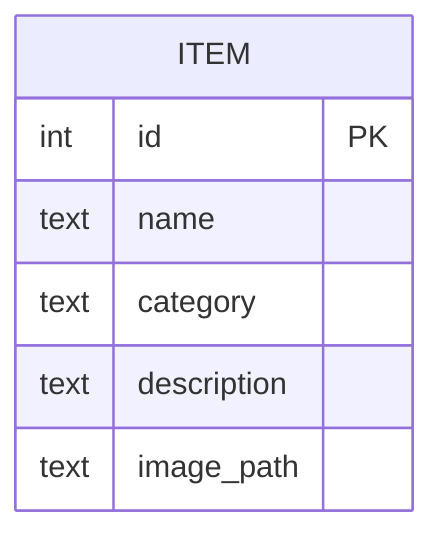
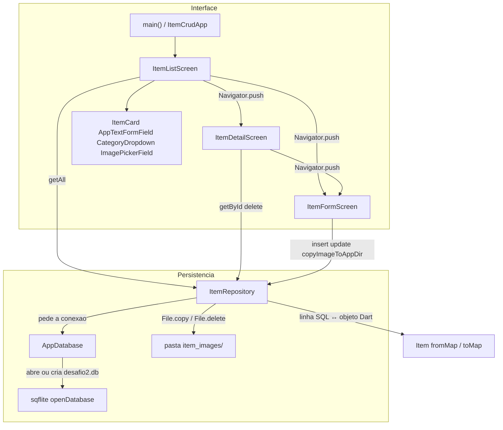
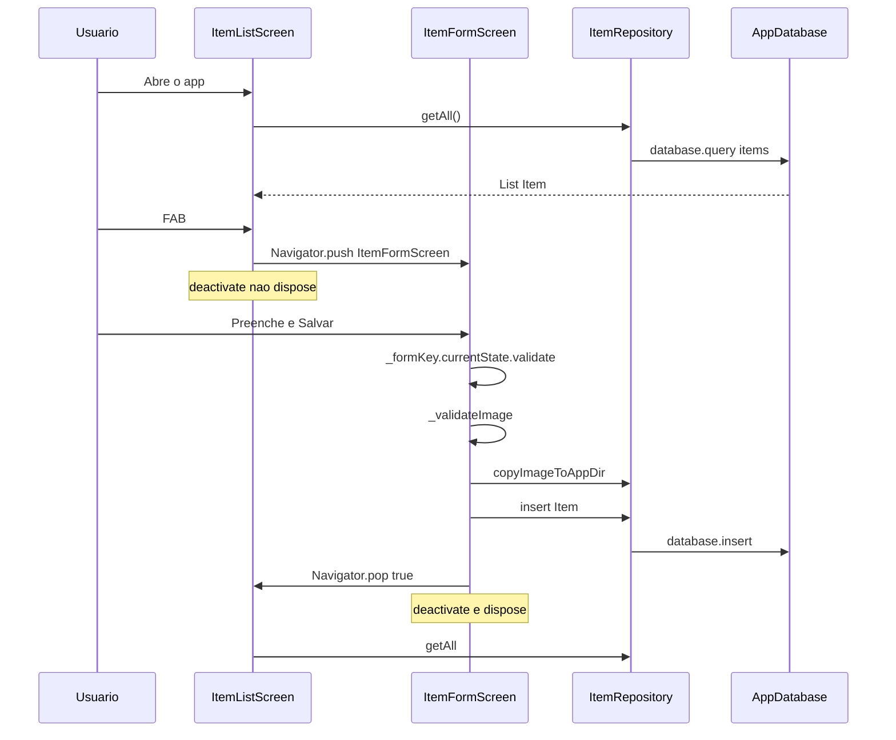
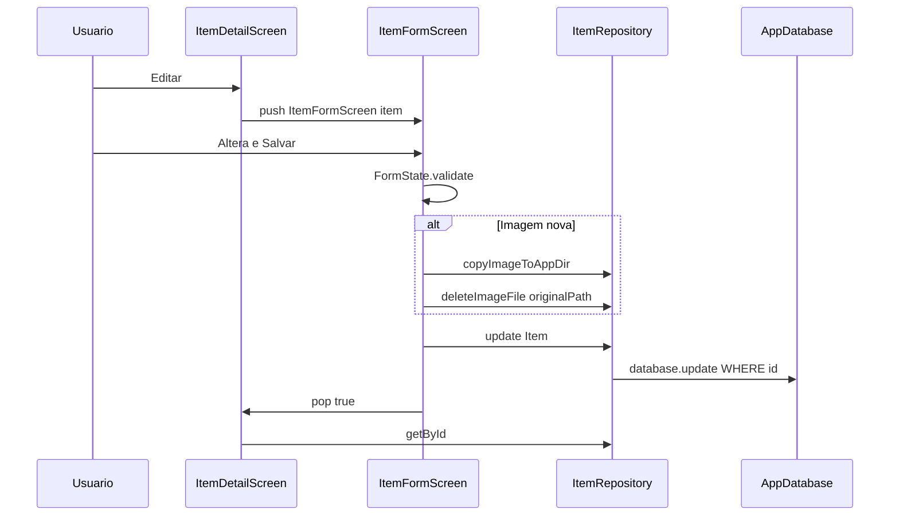
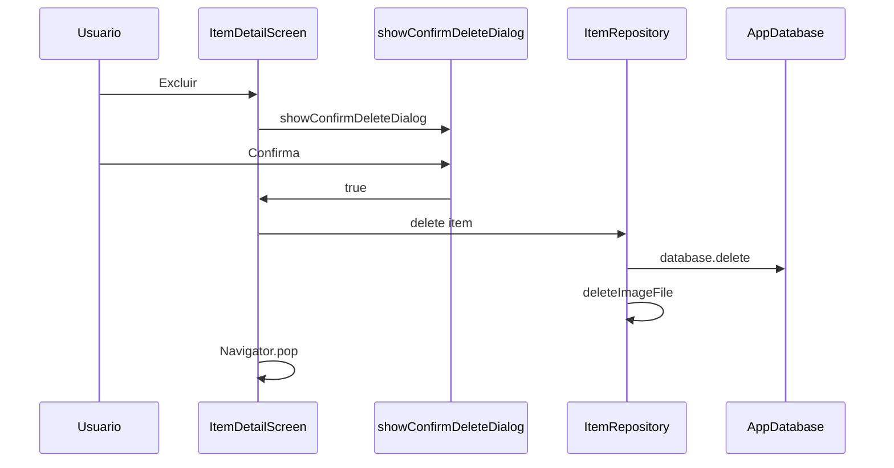
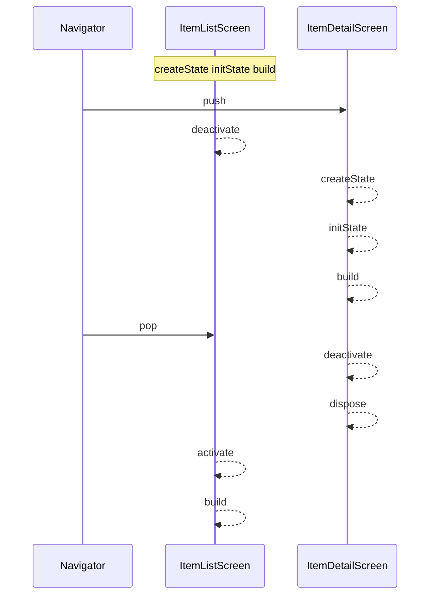

# Desafio 2 — Formulário dinâmico com persistência (SQLite)

Guia educativo do Desafio 2 (PDM2). Ao final você deve conseguir:

1. entender o enunciado e o que cada requisito treina;
2. **recriar** o app (modelo, SQLite, formulário, lista, detalhe);
3. explicar **formulários**, **validação**, **CRUD**, **armazenamento local**, **persistência**, **ListView** e **navegação**;
4. apontar **classe, objeto e método** de cada operação;
5. desenhar o **ER**, a **arquitetura** e a **sequência**;
6. observar no console `createState → initState → build → deactivate → dispose`.

---

## Como rodar

```bash
cd desafio_2
flutter pub get
flutter run
```

Só **Android e iOS** (aparelho ou emulador). O plugin `sqflite` nativo abre o banco; não há FFI de desktop.

Fluxo de teste:

1. Lista vazia → **Cadastrar item** (ou FAB `+`).
2. Preencha nome, categoria, descrição e imagem. Salvar vazio deve falhar na validação.
3. Salve: o item aparece no `ListView.builder`.
4. Toque no `ItemCard`: `ItemDetailScreen`.
5. Edite, salve, volte: dados novos (relidos do SQLite).
6. Exclua com `showConfirmDeleteDialog`: some da lista.
7. Feche e abra o app: os itens **continuam** (`desafio2.db` + pasta `item_images/`).
8. No console, filtre `[` e veja o ciclo de vida.

---

## Mapa do enunciado → código

O PDF pede cadastrar / consultar / alterar / excluir, com dados vivos depois de fechar o app. A tabela abaixo é o “quem faz o quê”.

### Persistência e armazenamento local (núcleo)

| Peça | Tipo | Onde | Papel |
|------|------|------|--------|
| `AppDatabase` | classe (singleton) | `lib/data/app_database.dart` | Abre `desafio2.db` e cria a tabela `items` |
| `AppDatabase.instance` | objeto | mesmo arquivo | Única conexão usada no app |
| `AppDatabase.database` | getter `Future<Database>` | mesmo arquivo | Devolve a conexão (`sqflite`) |
| `AppDatabase._open()` | método | mesmo arquivo | `getDatabasesPath()` + `openDatabase()` |
| `AppDatabase._onCreate()` | método | mesmo arquivo | `CREATE TABLE items (...)` |
| `ItemRepository` | classe | `lib/data/item_repository.dart` | Única porta das telas para o disco |
| `Item` | classe (modelo) | `lib/models/item.dart` | Objeto Dart ↔ linha SQLite |
| `Item.fromMap` / `Item.toMap` | factory / método | mesmo arquivo | `Map` do `sqflite` ↔ `Item` |
| arquivo `desafio2.db` | arquivo | pasta privada do app | Banco que **sobrevive** ao fechar |
| pasta `item_images/` | diretório | documentos do app (`path_provider`) | Fotos copiadas da galeria |

Pacotes: `sqflite` (SQL), `path_provider` (pasta das fotos), `image_picker` (galeria).

### CRUD — métodos explícitos

Tudo passa por um objeto `ItemRepository` criado em cada tela (`final ItemRepository _repository = ItemRepository()`).

| Operação do PDF | Método | Assinatura | SQL / disco |
|-----------------|--------|------------|-------------|
| **Consultar** todos | `ItemRepository.getAll` | `Future<List<Item>> getAll()` | `SELECT` em `items` (`ORDER BY id DESC`) |
| **Consultar** um | `ItemRepository.getById` | `Future<Item?> getById(int id)` | `SELECT ... WHERE id = ?` |
| **Cadastrar** | `ItemRepository.insert` | `Future<int> insert(Item item)` | `INSERT`; devolve o `id` do AUTOINCREMENT |
| **Alterar** | `ItemRepository.update` | `Future<int> update(Item item)` | `UPDATE ... WHERE id = ?` |
| **Excluir** | `ItemRepository.delete` | `Future<void> delete(Item item)` | `DELETE` + `deleteImageFile` |
| Persistir foto | `ItemRepository.copyImageToAppDir` | `Future<String> copyImageToAppDir(String sourcePath)` | Copia arquivo da galeria para `item_images/` |
| Apagar foto | `ItemRepository.deleteImageFile` | `Future<void> deleteImageFile(String imagePath)` | `File.delete()` |

Quem **chama** cada um:

| Quem chama | Método da tela | Chama no repositório |
|------------|----------------|----------------------|
| `_ItemListScreenState` | `_loadItems()` | `getAll()` |
| `_ItemDetailScreenState` | `_loadItem()` | `getById(widget.itemId)` |
| `_ItemFormScreenState` | `_submit()` | `copyImageToAppDir`, depois `insert` ou `update` |
| `_ItemDetailScreenState` | `_confirmAndDelete()` | `delete(item)` |

### Formulário e validação

| Peça | Tipo | Papel |
|------|------|--------|
| `ItemFormScreen` | `StatefulWidget` | Tela de Create (`item == null`) e Update (`item != null`) |
| `_ItemFormScreenState` | `State` | Guarda controllers, categoria, path da foto |
| `_formKey` | `GlobalKey<FormState>` | Dispara `validate()` em todos os campos do `Form` |
| `_nameController` / `_descriptionController` | `TextEditingController` | Texto digitado (nascem em `initState`, morrem em `dispose`) |
| `_validateName` / `_validateCategory` / `_validateDescription` | métodos `String? Function(String?)` | Regras do `Form` |
| `_validateImage` | `bool _validateImage()` | Imagem obrigatória no cadastro (fora do `Form`) |
| `_submit` | `Future<void> _submit()` | Valida + persiste + `Navigator.pop(context, true)` |
| `AppTextFormField` | `StatelessWidget` | `TextFormField` de nome e descrição |
| `CategoryDropdown` | `StatelessWidget` | `DropdownButtonFormField<String>` |
| `ImagePickerField` | `StatefulWidget` | Galeria + preview; estado `_path` |

### ListView e navegação

| Peça | Tipo | Papel |
|------|------|--------|
| `ItemListScreen` | `StatefulWidget` | Lista (Read de todos) |
| `_buildBody` | método | Spinner, erro, `EmptyState` ou `ListView.builder` |
| `ListView.builder` | widget Flutter | Só constrói os `ItemCard` visíveis (`itemBuilder`) |
| `ItemCard` | `StatelessWidget` | Miniatura, nome, categoria; `onTap` |
| `Navigator.push` | API Flutter | Empilha detalhe ou formulário (`MaterialPageRoute`) |
| `Navigator.pop` | API Flutter | Desempilha; `true` = “salvou, recarregue” |
| `_openCreateForm` | método da lista | `push` de `ItemFormScreen()` |
| `_openDetail` | método da lista | `push` de `ItemDetailScreen(itemId: item.id!)` |
| `_openEditForm` | método do detalhe | `push` de `ItemFormScreen(item: item)` |

---

## Diagrama ER

Uma entidade. `category` é `TEXT`, não tabela extra. A foto **não** é BLOB: `image_path` é o caminho do arquivo.



| Coluna SQL | Campo em `Item` | Tipo SQLite | Papel |
|------------|-----------------|-------------|--------|
| `id` | `id` (`int?`) | `INTEGER PRIMARY KEY AUTOINCREMENT` | Nulo só antes do `insert` |
| `name` | `name` | `TEXT NOT NULL` | 3–80 caracteres na validação |
| `category` | `category` | `TEXT NOT NULL` | Valor de `itemCategories` |
| `description` | `description` | `TEXT NOT NULL` | 10–500 caracteres |
| `image_path` | `imagePath` | `TEXT NOT NULL` | Path absoluto da foto na pasta privada do app |

O desafio pede nome, categoria, descrição e imagem. Não há `created_at` / `updated_at`.

O arquivo da foto: `{getApplicationDocumentsDirectory()}/item_images/{timestamp}.ext`. Fechar o app **não** apaga o `.db` nem essa pasta. A Galeria **não** vê essa cópia (ver [Onde a foto fica no celular](#onde-a-foto-fica-no-celular)).

---

## Diagrama de arquitetura

Mapa **estático**: classes e quem usa quem. Não é o tempo.



O `ItemRepository` é o **hub** da persistência: as telas só apontam para ele. Dele saem **três** setas, cada uma para um tipo de armazenamento ou de tradução — não para a mesma coisa com nomes diferentes.

### As setas que saem do `ItemRepository`

#### 1. `ItemRepository` → `AppDatabase` → `sqflite openDatabase`

Cadeia em **dois degraus**. O repositório **não** chama `openDatabase`. Ele pede a conexão; quem abre o arquivo é o `AppDatabase`.

| Degrau | Seta | O que acontece no código |
|--------|------|---------------------------|
| Hub → dono do arquivo | `ItemRepository` → `AppDatabase` | Campo `_database` (padrão `AppDatabase.instance`). Getter `_db` faz `await _database.database`. |
| Dono do arquivo → plugin | `AppDatabase` → `openDatabase` | `_open()` monta `…/desafio2.db` e chama `openDatabase(path, version: 2, onCreate: _onCreate, onUpgrade: ...)`. |

O objeto que volta é um `Database` do `sqflite`. **Aí** o repositório usa essa conexão para o CRUD da tabela (`db.query`, `db.insert`, `db.update`, `db.delete`). Abrir o arquivo e falar SQL são responsabilidades diferentes:

- **`AppDatabase`**: existe o arquivo? criar tabela? uma conexão por processo (`_db ??=`).
- **`ItemRepository`**: o que fazer **depois** que a conexão existe (`SELECT` / `INSERT` / `UPDATE` / `DELETE` em `items`).

Por isso a seta não vai direto `Repo → openDatabase`: se o repositório abrisse o `.db` sozinho, o esquema (`CREATE TABLE`) e o singleton vazariam para a classe de CRUD.

#### 2. `ItemRepository` → `item_images/` (`copyImageToAppDir`)

Seta **irmã** da do banco, não um atalho para o SQLite. A foto **não** entra como BLOB.

O `image_picker` devolve um path **temporário** da galeria. Esse arquivo pode sumir. Por isso `_submit` chama `copyImageToAppDir` **antes** do `insert`/`update`:

```dart
Future<String> copyImageToAppDir(String sourcePath) async {
  final Directory documents = await getApplicationDocumentsDirectory();
  final Directory imagesDir = Directory(
    _join(documents.path, imagesFolderName), // item_images
  );
  if (!await imagesDir.exists()) {
    await imagesDir.create(recursive: true);
  }
  final String fileName =
      '${DateTime.now().millisecondsSinceEpoch}$extension';
  final String destinationPath = _join(imagesDir.path, fileName);
  await File(sourcePath).copy(destinationPath);
  return destinationPath; // este path vai para a coluna image_path
}
```

Passo a passo:

1. **`getApplicationDocumentsDirectory()`** — pasta de documentos **do próprio app** (`path_provider`). Não é a Galeria, não é Downloads.
2. **Subpasta `item_images/`** — criada se ainda não existir (`create(recursive: true)`).
3. **Nome único** — `millisecondsSinceEpoch` + extensão (`.jpg`, etc.) para não sobrescrever outra foto.
4. **`File(sourcePath).copy(destinationPath)`** — **copia**. A original na Galeria continua lá. O app passa a usar só o arquivo novo.
5. **Devolve o path absoluto** — gravado em `Item.imagePath` / coluna `image_path`. `ItemImage` faz `Image.file(File(imagePath))`.

`deleteImageFile` faz `File.delete` nesse path (exclusão do item, ou troca de foto na edição). Sem a cópia, o `INSERT` gravaria um path da galeria que some ao fechar o app.

Detalhe de **onde isso mora no celular** e se dá para abrir fora do app: [Onde a foto fica no celular](#onde-a-foto-fica-no-celular).

#### 3. `ItemRepository` → `Item` (`fromMap` / `toMap`)

O `sqflite` não devolve `Item`. Devolve `List<Map<String, dynamic>>` com nomes de **coluna** (`image_path`). A UI não fala esse mapa: fala objeto (`item.name`, `item.imagePath`).

| Direção | Método | Quando o repositório usa |
|---------|--------|--------------------------|
| SQL → Dart | `Item.fromMap` | Depois de `db.query` em `getAll` e `getById` |
| Dart → SQL | `Item.toMap` | Antes de `db.insert` e `db.update` |

`fromMap` traduz `map['image_path']` → `imagePath`. `toMap` faz o inverso e omite `id` nulo (AUTOINCREMENT no cadastro). Sem essa seta, as telas teriam que conhecer colunas SQLite.

Resumo das três setas: **arquivo `.db`** (via `AppDatabase` / `openDatabase`), **arquivos de foto** (pasta `item_images/`), **formato dos dados** (`Item`). O repositório junta os três; a tela só vê `List<Item>` / `Item`.

### Como ler o restante do diagrama

Cada caixa é uma classe (ou função). Cada seta é **uma chamada no código**. De cima para baixo:

1. **Interface** — `main()` sobe `ItemCrudApp` (`MaterialApp`, `home: ItemListScreen`).
2. **Telas não chamam `openDatabase` nem `File.copy`.** Chamam `_repository.getAll()` / `insert()` / `copyImageToAppDir` / etc.
3. As três setas que **saem** do `ItemRepository` estão na seção acima.

Sem Provider. Cada `State` usa `setState`.

O diagrama é estático. A demonstração abaixo abre os arquivos na ordem das setas. As **três setas que saem do `ItemRepository`** estão nos passos 3 (conexão / `openDatabase`), 4 (arquivo `.db`) e 5 (modelo); a pasta `item_images/` aparece no recorte de cadastro.

### Como mostrar isso no código

Abra os arquivos nesta ordem. O caminho abaixo é **abrir o app e ver a lista** (Read): a seta `ItemListScreen --getAll--> ItemRepository --> AppDatabase --> sqflite`.

#### 1. Interface: `main()` sobe `ItemCrudApp`

Em `lib/main.dart`, `runApp` monta a raiz. O `home` é a lista — não o banco.

```dart
void main() {
  WidgetsFlutterBinding.ensureInitialized();
  runApp(const ItemCrudApp());
}

class ItemCrudApp extends StatelessWidget {
  @override
  Widget build(BuildContext context) {
    return MaterialApp(
      home: const ItemListScreen(), // caixa ListScreen do diagrama
    );
  }
}
```

O `MaterialApp` cria o `Navigator` (setas `Navigator.push` no diagrama).

#### 2. Tela fala com o repositório, não com o SQLite

Em `lib/screens/item_list_screen.dart`, o `State` **instancia** o objeto da caixa `ItemRepository` e, no `initState`, dispara a leitura:

```dart
class _ItemListScreenState extends State<ItemListScreen> {
  final ItemRepository _repository = ItemRepository(); // objeto, não sqflite
  List<Item> _items = <Item>[];

  @override
  void initState() {
    super.initState();
    _loadItems();
  }

  Future<void> _loadItems() async {
    final List<Item> items = await _repository.getAll(); // seta getAll
    setState(() => _items = items);
  }
}
```

Não há `import 'package:sqflite/sqflite.dart'` nesta tela. A prova da camada: a lista só conhece `ItemRepository` e `Item`.

O `ListView` consome `_items` (já convertido). A seta `ListScreen --> Widgets` é o `itemBuilder` devolvendo `ItemCard`:

```dart
return ListView.builder(
  itemCount: _items.length,
  itemBuilder: (BuildContext context, int index) {
    return ItemCard(
      item: _items[index],
      onTap: () => _openDetail(_items[index]), // seta Navigator.push
    );
  },
);
```

`Navigator.push` para o detalhe / formulário está em `_openDetail` e `_openCreateForm` no mesmo arquivo.

#### 3. Repositório: `sqflite` + `fromMap` (ainda sem a tela saber)

Em `lib/data/item_repository.dart`, o construtor liga a caixa `Repo` à caixa `AppDatabase`:

```dart
class ItemRepository {
  ItemRepository({AppDatabase? database})
      : _database = database ?? AppDatabase.instance;

  final AppDatabase _database;
  Future<Database> get _db async => _database.database;
```

`getAll` é a seta `Repo --> Db` **e** a seta `Repo --> Item`:

```dart
Future<List<Item>> getAll() async {
  final Database db = await _db;              // pede a conexão ao singleton
  final List<Map<String, dynamic>> rows = await db.query(
    AppDatabase.itemsTable,                   // SQL: SELECT na tabela items
    orderBy: 'id DESC',
  );
  return rows.map(Item.fromMap).toList();     // Map do sqflite → objeto Item
}
```

`db.query` / `db.insert` / `db.update` / `db.delete` são as únicas chamadas `sqflite` do app. Elas moram aqui, não nas telas.

#### 4. `AppDatabase`: arquivo `desafio2.db`

Em `lib/data/app_database.dart`, a caixa `Db` é um singleton. `_open` chama `openDatabase` (caixa `sqflite`):

```dart
class AppDatabase {
  AppDatabase._();
  static final AppDatabase instance = AppDatabase._();

  Future<Database> get database async {
    _db ??= await _open();
    return _db!;
  }

  Future<Database> _open() async {
    final String databasesPath = await getDatabasesPath();
    final String path = '$databasesPath/$dbName'; // desafio2.db
    return openDatabase(path, version: dbVersion, onCreate: _onCreate);
  }
}
```

Dois “primeira vez” diferentes:

| O quê | Onde | O que trava a repetição |
|-------|------|-------------------------|
| Abrir a conexão neste processo | getter `database` (`_db ??=`) | `_db` já preenchido na RAM |
| Criar a tabela `items` | callback `_onCreate` | o **arquivo** `desafio2.db` já existe no disco |

O app **não** tem um `if (primeiraExecucao)`. Quem decide é o `openDatabase` do `sqflite`:

1. Monta o path (`…/desafio2.db`).
2. Se o arquivo **não** existe: cria o arquivo, grava `PRAGMA user_version = 2` (`dbVersion`) e **aí sim** chama `_onCreate` → `CREATE TABLE items`.
3. Se o arquivo **já** existe: abre o que está no disco e **não** chama `_onCreate`. A tabela e as linhas continuam. É isso que impede o `CREATE TABLE` nas outras execuções — e o que faz os itens sobreviverem ao fechar o app.

Se `_onCreate` rodasse de novo com o mesmo SQL, o SQLite falharia (`table items already exists`). Recriar a tabela a cada abertura também apagaria os dados. A versão atual é `2` (sem datas): `onUpgrade` dá `DROP TABLE` e chama `_onCreate` de novo **só** quando o arquivo antigo ainda está na versão `1`.

#### 5. Modelo: linha SQL ↔ objeto

Em `lib/models/item.dart`, `fromMap` lê o `Map` que o `sqflite` devolveu; `toMap` monta o `Map` do `insert` / `update`:

```dart
factory Item.fromMap(Map<String, dynamic> map) { /* map['name'] → name */ }

Map<String, dynamic> toMap() {
  return {
    if (id != null) 'id': id,
    'name': name,
    'image_path': imagePath,
    // ...
  };
}
```

No Read, só `fromMap` entra no jogo (`getAll` / `getById`). No Create/Update, a tela monta um `Item` e o repositório chama `item.toMap()` dentro de `insert` / `update`. O `sqflite` **não** aceita o objeto `Item`; aceita um `Map` cujas chaves são os nomes das colunas.

---

O mesmo recorte para **cadastrar** (setas `FormScreen --insert / copyImageToAppDir--> Repo`):

Em `lib/screens/item_form_screen.dart`, `_submit` valida e **só então** chama o repositório:

```dart
Future<void> _submit() async {
  if (!(_formKey.currentState?.validate() ?? false) || !_validateImage()) {
    return;
  }
  persistedImagePath = await _repository.copyImageToAppDir(persistedImagePath);
  await _repository.insert(created); // ou update(updated) na edição
  Navigator.pop(context, true);
}
```

Em `item_repository.dart`, `copyImageToAppDir` é a seta `Repo --> item_images/` (`File.copy`). `insert` é a seta `Repo --> Db`:

```dart
Future<int> insert(Item item) async {
  final Database db = await _db;
  return db.insert(AppDatabase.itemsTable, item.toMap());
}
```

`insert` só precisa do mapa: é linha **nova**. Não há `where`.

Para **alterar**, o `update` tem **duas** partes que não se misturam:

```dart
return db.update(
  AppDatabase.itemsTable,
  item.toMap(),              // SET: valores novos (name, category, …)
  where: 'id = ?',           // qual linha? placeholder, não o número
  whereArgs: <Object>[item.id!], // o valor que substitui o `?`
);
```

Isso vira, no SQLite, algo equivalente a:

```sql
UPDATE items
SET name = ?, category = ?, description = ?, image_path = ?, id = ?
WHERE id = ?;
```

(o `SET` vem das entradas de `toMap()`; o último `?` do `WHERE` vem de `whereArgs`).

| Peça | Papel | Se faltasse |
|------|--------|-------------|
| `item.toMap()` | Conteúdo a gravar. Chaves = colunas (`image_path`, não o campo Dart `imagePath`). | O `sqflite` não saberia o que colocar no `SET`. |
| `where: 'id = ?'` | Recorte SQL. O `?` **não** é interpolação Dart; é parâmetro ligado. | Sem `where`, o `db.update` altera **todas** as linhas da tabela. |
| `whereArgs: <Object>[item.id!]` | Lista na ordem dos `?`. `<Object>` é o tipo da lista (`List<Object>`), que é o que o `sqflite` espera em `whereArgs`. | O `?` ficaria sem valor; a query falha. |
| `item.id!` | `id` no modelo é `int?` (nulo só antes do cadastro). Em update/delete o item **já** tem PK; o `!` afirma isso ao compilador. | Sem PK não dá para apontar a linha. |

Não se escreve `'id = ${item.id}'`. O valor vai em `whereArgs` para o plugin fazer o bind (e evitar montar SQL na mão). O `toMap()` **não** escolhe a linha: mesmo que o mapa contenha `'id': 3`, quem restringe o `UPDATE`/`DELETE` é o `where`. O mapa diz *o quê* mudar; o `where` diz *qual* registro.

No `getById` o parâmetro já é `int` (não `int?`), então é `whereArgs: <Object>[id]` — sem `!`.

`getById` e `delete` usam o mesmo padrão (`where: 'id = ?'`, `whereArgs: [id]` ou `[item.id!]`). No `delete` não há `toMap`: não há valores novos, só a linha a apagar (+ `deleteImageFile`).

Para **excluir**, em `item_detail_screen.dart`: `_confirmAndDelete` → `_repository.delete(item)`. No repositório, `delete` faz `db.delete` **e** `deleteImageFile` (SQL + disco na mesma operação).

| Seta do diagrama | Arquivo para abrir | O que apontar |
|------------------|--------------------|---------------|
| `main / ItemCrudApp` → lista | `lib/main.dart` | `home: const ItemListScreen()` |
| lista → widgets | `lib/screens/item_list_screen.dart` | `ListView.builder` + `ItemCard` |
| lista → `Navigator.push` | mesmo arquivo | `_openCreateForm`, `_openDetail` |
| lista → `getAll` | mesmo arquivo | `_repository.getAll()` em `_loadItems` |
| detalhe → `getById` / `delete` | `lib/screens/item_detail_screen.dart` | `_loadItem`, `_confirmAndDelete` |
| form → `insert` / `update` / foto | `lib/screens/item_form_screen.dart` | `_submit` |
| `Repo` → `AppDatabase` (pede a conexão) | `lib/data/item_repository.dart` | `_database = AppDatabase.instance`, getter `_db` |
| `AppDatabase` → `openDatabase` (abre o `.db`) | `lib/data/app_database.dart` | `_open`, `_onCreate` |
| `Repo` usa o `Database` (CRUD SQL) | `lib/data/item_repository.dart` | `db.query` / `insert` / `update` / `delete` |
| `Repo` → `item_images/` | mesmo arquivo | `copyImageToAppDir` (`File.copy`), `deleteImageFile` |
| `Repo` → `Item` (`fromMap` / `toMap`) | `lib/models/item.dart` | `fromMap` após o `query`; `toMap` no `insert`/`update` |

---

## Diagramas de sequência

### Cadastro — `insert` + `copyImageToAppDir`



### Alteração — `update`



### Exclusão — `delete`



### Ciclo de vida (`LifecycleLogger`)



`push` **não** mata o `State` da lista. `deactivate` ≠ `dispose`.

---

## Pastas

```text
desafio_2/lib/
├── main.dart
├── models/item.dart
├── data/
│   ├── app_database.dart
│   ├── item_repository.dart
│   └── categories.dart
├── screens/
│   ├── item_list_screen.dart
│   ├── item_detail_screen.dart
│   └── item_form_screen.dart
└── widgets/
    ├── lifecycle_logger.dart
    ├── item_card.dart
    ├── item_image.dart
    ├── app_text_form_field.dart
    ├── category_dropdown.dart
    ├── image_picker_field.dart
    ├── confirm_delete_dialog.dart
    └── empty_state.dart
```

---

## Decisões

### Por que `_onCreate` só na primeira execução?

Não é o nosso código que “lembra” a primeira vez. `openDatabase(..., onCreate: _onCreate)` só dispara o callback se o arquivo do banco **ainda não existir**. Depois disso o `desafio2.db` no disco é o que impede um novo `CREATE TABLE` — senão o SQLite recusaria a tabela duplicada e, se recriássemos, perderíamos o CRUD persistido.

### Por que SQLite e não `shared_preferences`?

Persistência com consulta/alteração/exclusão por `id` pede tabela, `WHERE` e `AUTOINCREMENT`. `SharedPreferences` serve para flag, não para CRUD.

### Por que `imagePath` (arquivo) e não BLOB?

`ItemRepository.copyImageToAppDir` copia para `item_images/`. A coluna `image_path` só guarda o path. `Image.file` lê o disco. `delete` apaga a linha **e** o arquivo. O path da galeria é temporário. A cópia fica no sandbox do app — a Galeria não a vê (ver [Onde a foto fica no celular](#onde-a-foto-fica-no-celular)).

### Por que só Android/iOS?

`sqflite` nativo no celular. Sem `sqflite_common_ffi` e sem o pacote `path`. Caminhos com `/`.

### Por que três telas?

| Classe | Operação | Conteúdo |
|--------|----------|----------|
| `ItemListScreen` | Read (todos) | `ListView.builder`, `EmptyState`, FAB |
| `ItemDetailScreen` | Read (um) + Delete | `itemId`, `getById`, `delete` |
| `ItemFormScreen` | Create e Update | `Form`, validadores, `insert` / `update` |

### Por que o mixin `LifecycleLogger`?

Evita copiar logs em cada `State`. `build` e `createState` ficam fora do mixin (o log de `createState` está no widget; o de `build`, na primeira linha do `build`). `activate` é o par de `deactivate`.

### Por que uns widgets são `StatelessWidget`?

`ItemCard`, `AppTextFormField`, `CategoryDropdown`, `EmptyState`, `ItemImage` não guardam estado. `ImagePickerField` guarda `_path`.

### Por que `Item.id` nulo no cadastro?

`toMap()` omite `id`. O SQLite preenche com `AUTOINCREMENT`. `insert` devolve o inteiro. Depois disso o `id` deixa de ser nulo — é o valor de `whereArgs` no `update` / `delete`.

### Por que `toMap` e `where` / `whereArgs` no `update`?

São papéis diferentes no SQL:

- `item.toMap()` → colunas do `SET` (objeto Dart vira `Map` com nomes de coluna).
- `where: 'id = ?'` + `whereArgs: <Object>[item.id!]` → `WHERE` (só aquela PK). O `?` é placeholder; `<Object>` tipa a lista; o `!` porque `id` é `int?` e no update já existe.

Sem o `where`, o `sqflite` atualizaria a tabela inteira. O `insert` não usa `where` porque a linha ainda não existe.

### Regras de `_validateName` / `_validateCategory` / `_validateDescription` / `_validateImage`

| Campo | Método | Regras |
|-------|--------|--------|
| Nome | `_validateName` | obrigatório, 3–80 (`trim`) |
| Categoria | `_validateCategory` | não nulo |
| Descrição | `_validateDescription` | obrigatória, 10–500 |
| Imagem | `_validateImage` | obrigatória no cadastro |

Nome, categoria e descrição: `FormState.validate`. Imagem: método à parte (`ImagePickerField` não é `FormField`).

---

## Cada arquivo: tipo, classe, método

### `lib/main.dart`

| Símbolo | Tipo | O que faz |
|---------|------|-----------|
| `main()` | função | `WidgetsFlutterBinding.ensureInitialized()` + `runApp` |
| `ItemCrudApp` | `StatelessWidget` | `MaterialApp` (cria o `Navigator`) |
| `ItemCrudApp.build` | método | `home: ItemListScreen()` |

O `sqflite` nativo já registra a fábrica no Android/iOS. Nada de FFI aqui.

### `lib/models/item.dart` — objeto persistido

| Símbolo | Tipo | O que faz |
|---------|------|-----------|
| `Item` | classe imutável | Uma linha da tabela `items` |
| `id`, `name`, `category`, `description`, `imagePath` | campos `final` | Dados do registro |
| `Item.fromMap` | `factory` | `Map<String, dynamic>` do `sqflite` → `Item` |
| `Item.toMap` | `Map<String, dynamic> toMap()` | `Item` → mapa de `insert`/`update` (chaves = colunas SQL; omite `id` nulo) |
| `Item.copyWith` | método | Cópia para o `update` sem mutar o original |

### `lib/data/app_database.dart` — abertura do banco

| Símbolo | Tipo | O que faz |
|---------|------|-----------|
| `AppDatabase` | classe singleton | Dono do arquivo `desafio2.db` |
| `AppDatabase._()` | construtor privado | Impede `AppDatabase()` de fora |
| `instance` | `static final AppDatabase` | Objeto único |
| `dbName` | `static const String` | `'desafio2.db'` |
| `dbVersion` | `static const int` | `2` (sem colunas de data) |
| `itemsTable` | `static const String` | `'items'` |
| `database` | getter | Abre neste processo (`_db ??=` + `_open`) |
| `_open()` | `Future<Database>` | `getDatabasesPath()` + `openDatabase` |
| `_onCreate` | callback do `sqflite` | `CREATE TABLE`; só se `desafio2.db` ainda não existir |
| `onUpgrade` | callback | `DROP TABLE` + `_onCreate` ao subir da versão `1` para `2` |

### `lib/data/item_repository.dart` — persistência (CRUD)

| Símbolo | Tipo | O que faz |
|---------|------|-----------|
| `ItemRepository` | classe | Isola `sqflite` e arquivos das telas |
| `_database` | `AppDatabase` | Padrão: `AppDatabase.instance` |
| `imagesFolderName` | `static const` | `'item_images'` |
| `_db` | getter | `_database.database` |
| `getAll()` | **consultar** | `db.query` → `List<Item>` |
| `getById(int id)` | **consultar** | um `Item` ou `null` |
| `insert(Item item)` | **cadastrar** | `db.insert(tabela, item.toMap())`; sem `where` |
| `update(Item item)` | **alterar** | `toMap()` = SET; `where: 'id = ?'` + `whereArgs: [item.id!]` = a linha |
| `delete(Item item)` | **excluir** | mesmo `where`/`whereArgs`; sem `toMap`; + `deleteImageFile` |
| `copyImageToAppDir` | persistir foto | `File.copy` para a pasta do app |
| `deleteImageFile` | disco | apaga o arquivo da foto |
| `_join` / `_fileExtension` | privados | path com `/`, sem pacote `path` |

### `lib/data/categories.dart`

| Símbolo | Tipo | O que faz |
|---------|------|-----------|
| `itemCategories` | `const List<String>` | Casa, Trabalho, Estudo, Lazer, Outros |

Usado por `CategoryDropdown`. Gravado em `Item.category` / coluna `category`.

### `lib/widgets/lifecycle_logger.dart`

| Símbolo | Tipo | O que faz |
|---------|------|-----------|
| `logLifecycle` | função | `debugPrint('[ItemListScreen] initState')` |
| `LifecycleLogger` | mixin em `State` | Loga `initState`, `deactivate`, `activate`, `dispose` |
| `lifecycleName` | getter | Rótulo entre colchetes |

Usado por `_ItemListScreenState`, `_ItemDetailScreenState`, `_ItemFormScreenState`, `_ImagePickerFieldState`.

### Widgets de UI

| Arquivo | Classe | Tipo | Papel |
|---------|--------|------|--------|
| `item_image.dart` | `ItemImage` | `StatelessWidget` | `Image.file`; `_ImageFallback` se o arquivo sumir |
| `item_card.dart` | `ItemCard` | `StatelessWidget` | Card da lista; campo `onTap` |
| `app_text_form_field.dart` | `AppTextFormField` | `StatelessWidget` | `TextFormField` + `validator` |
| `category_dropdown.dart` | `CategoryDropdown` | `StatelessWidget` | `DropdownButtonFormField`; `initialValue` |
| `image_picker_field.dart` | `ImagePickerField` | `StatefulWidget` | `_pickFromGallery` → `ImagePicker.pickImage` |
| `confirm_delete_dialog.dart` | `ConfirmDeleteDialog` | `StatelessWidget` | `AlertDialog` |
| `confirm_delete_dialog.dart` | `showConfirmDeleteDialog` | função | `Future<bool>` |
| `empty_state.dart` | `EmptyState` | `StatelessWidget` | Lista vazia ou erro |

`ImagePickerField.initState` copia `initialPath`. `imageQuality: 85` no `pickImage`.

### `lib/screens/item_list_screen.dart` — consultar todos

| Símbolo | Tipo | O que faz |
|---------|------|-----------|
| `ItemListScreen` | `StatefulWidget` | Tela inicial |
| `_ItemListScreenState` | `State` + mixin | Estado da lista |
| `_repository` | `ItemRepository` | Persistência |
| `_items` | `List<Item>` | O que o `ListView` desenha |
| `_loadItems()` | método | `await _repository.getAll()` + `setState` |
| `_openCreateForm()` | navegação | `Navigator.push` → `ItemFormScreen()`; se `true`, `_loadItems` |
| `_openDetail(Item)` | navegação | `push` → `ItemDetailScreen(itemId: ...)`; depois `_loadItems` |
| `build` | UI | `Scaffold` + FAB (`_openCreateForm`) |
| `_buildBody()` | UI | `ListView.builder` / `EmptyState` / spinner |

### `lib/screens/item_detail_screen.dart` — consultar um e excluir

| Símbolo | Tipo | O que faz |
|---------|------|-----------|
| `ItemDetailScreen` | `StatefulWidget` | Campo `itemId` |
| `_loadItem()` | método | `_repository.getById` |
| `_openEditForm()` | navegação | `ItemFormScreen(item: item)` |
| `_confirmAndDelete()` | **excluir** | `showConfirmDeleteDialog` → `_repository.delete` → `pop` |

### `lib/screens/item_form_screen.dart` — cadastrar e alterar

| Símbolo | Tipo | O que faz |
|---------|------|-----------|
| `ItemFormScreen.item` | `Item?` | `null` = Create; preenchido = Update |
| `_formKey` | `GlobalKey<FormState>` | `validate()` |
| `_validateName` etc. | validação | ver tabela de regras |
| `_submit()` | **persistir** | valida; `copyImageToAppDir`; `insert` ou `update`; `pop(true)` |
| `_saving` | `bool` | Desliga o botão durante o `await` |
| `dispose` | ciclo | `_nameController.dispose()` antes de `super.dispose()` |

---

## Como observar o ciclo de vida

1. `flutter run`, console visível, filtro `[`.
2. Abrir um item:

```text
[ItemListScreen] deactivate
[ItemDetailScreen] createState
[ItemDetailScreen] initState
[ItemDetailScreen] build
```

3. Voltar:

```text
[ItemDetailScreen] deactivate
[ItemDetailScreen] dispose
[ItemListScreen] activate
[ItemListScreen] build
```

4. Cadastro: a lista só `deactivate`; `ItemFormScreen` **e** `ImagePickerField` passam por `createState → initState → build`. No `pop`, os dois dão `dispose`.

`build` várias vezes (`setState`) é normal. Nascer = `createState` + `initState`. Morrer = `dispose`.

---

## O que o SQLite guarda (não é a foto)

Há **dois** lugares. O banco **não** armazena pixels.

```text
Galeria (arquivo temporário)
        │  File.copy  (bytes JPEG/PNG vão para o disco)
        ▼
  pasta privada do app          SQLite (desafio2.db)
  item_images/1724….jpg    ←→   coluna image_path = TEXT
  (arquivo de verdade)          (só a string do caminho)
```

Exemplo do que fica em cada um, depois de salvar:

| Onde | Conteúdo real | Formato |
|------|----------------|---------|
| Coluna `image_path` em `items` | `"/data/user/0/com.example.desafio_2/app_flutter/item_images/1724450123456.jpg"` | `TEXT` (string). **Não** é BLOB, **não** é Base64, **não** é o JPEG. |
| Arquivo nesse path | os bytes da foto | JPEG/PNG no disco, fora do `.db` |
| Arquivo `desafio2.db` | linhas da tabela `items` | SQLite |

O `insert` só manda um `Map`. A chave `'image_path'` é uma `String`:

```dart
// lib/models/item.dart — toMap()
'image_path': imagePath,  // String: o path, não os bytes

// lib/data/item_repository.dart — insert()
db.insert(AppDatabase.itemsTable, item.toMap());
```

Equivalente SQL:

```sql
INSERT INTO items (name, category, description, image_path)
VALUES ('Caderno', 'Estudo', 'Capa azul', '/data/user/0/.../item_images/1724450123456.jpg');
```

Para **mostrar** a foto, o app não lê a imagem de dentro do SQLite. Lê o arquivo cujo caminho veio da coluna:

```dart
// lib/widgets/item_image.dart
Image.file(File(imagePath))  // imagePath = o TEXT que veio do SELECT
```

Fluxo no cadastro (`_submit`):

1. `copyImageToAppDir` copia o arquivo e **devolve a string** do destino.
2. Essa string vira `Item.imagePath`.
3. `insert`/`update` grava a string em `image_path`.

Se o arquivo no disco for apagado e a linha no banco ficar, o `SELECT` ainda devolve o path — mas `Image.file` falha (por isso existe o fallback).

---

## Onde a foto fica no celular (e por que o app Arquivos não vê)

O path **existe** no Android. Ter path ≠ pasta pública.

### Por que copiar? (`copyImageToAppDir`)

O `image_picker` devolve um arquivo **temporário** (cache da galeria). Esse path pode ser apagado pelo sistema. O método **copia** esse arquivo para a pasta privada do app e devolve o path novo — é esse path que entra em `image_path`.

| Passo no código | O que faz |
|-----------------|-----------|
| `getApplicationDocumentsDirectory()` | Pasta de documentos **deste app** (sandbox). Não é a Galeria. |
| pasta `item_images/` | Subpasta criada se não existir. |
| nome `timestamp + extensão` | Evita dois itens com o mesmo nome de arquivo. |
| `File(sourcePath).copy(...)` | Cópia. A foto original **continua** na Galeria. |
| `return destinationPath` | Gravado no SQLite; `ItemImage` lê com `Image.file`. |

### Onde é, no disco

| Sistema | Caminho típico |
|---------|----------------|
| Android | `/data/data/com.example.desafio_2/app_flutter/item_images/` |
| iOS | `.../Documents/item_images/` (dentro do container do app) |

Essa área é **privada** (sandbox):

- A Galeria **não** lista esses arquivos (o app não publica no `MediaStore` / Phototeca).
- O app Arquivos / Explorador de arquivos do celular **não** mostra essa pasta no uso normal.
- Sem root / sem `adb`, você não “abre a pasta” como uma foto comum.
- **Desinstalar o app apaga** o `.db` e as imagens copiadas.
- A foto que você escolheu na Galeria **não é movida nem apagada**; só existe uma cópia extra só do app.

Quem desenvolve pode inspecionar no Android com `adb` (`run-as com.example.desafio_2`). No dia a dia, a imagem **só aparece dentro deste aplicativo** (lista, detalhe, formulário).

### Por que existe um path e o app Arquivos mesmo assim não vê?

No Android há dois mundos de disco:

| Área | Exemplos | O app Arquivos vê? |
|------|----------|-------------------|
| **Armazenamento compartilhado** | Galeria, Download, DCIM, Pictures | Sim (é isso que o Arquivos lista) |
| **Armazenamento interno do app** | `/data/data/<pacote>/…` (UID do app) | **Não** |

`getApplicationDocumentsDirectory()` aponta para o **interno**. O sistema cria essa pasta com permissão só do nosso UID. O app Arquivos roda com **outro** UID: o kernel do Linux/Android recusa a leitura. Não é o Flutter “escondendo” o arquivo; é o sandbox do SO.

Ter um path absoluto (`/data/user/0/.../1724.jpg`) só significa “este processo sabe o endereço”. Não torna a pasta pública. Para a Galeria/Arquivos verem, teríamos que copiar para Pictures/`MediaStore` — o desafio não pede isso.

O `desafio2.db` está na mesma lógica: também é arquivo interno (`getDatabasesPath()`), também invisível no Arquivos.

---

## Persistência depois de fechar o app

1. `AppDatabase._open()` grava `desafio2.db` em `getDatabasesPath()`.
2. `ItemRepository.copyImageToAppDir` grava a foto em `{documentos}/item_images/` (pasta **privada**; não é a Galeria).
3. Matar o processo **não** apaga esses arquivos.
4. Na próxima abertura, `ItemListScreen.initState` → `_loadItems()` → `getAll()` → `ListView.builder`.

Se os itens sumissem ao fechar: banco em memória, ou foto só no cache da galeria (sem `copyImageToAppDir`).

---

## Dependências (`pubspec.yaml`)

| Pacote | Objetos / APIs usadas |
|--------|------------------------|
| `sqflite` | `openDatabase`, `Database.query` / `insert` / `update` / `delete`, `getDatabasesPath` |
| `path_provider` | `getApplicationDocumentsDirectory()` |
| `image_picker` | `ImagePicker.pickImage(source: ImageSource.gallery)` |

Sem `sqflite_common_ffi` e sem `path`.

Permissões: Android `READ_MEDIA_IMAGES` (API 33+) e `READ_EXTERNAL_STORAGE` até 32; iOS `NSPhotoLibraryUsageDescription`.

---

## Fora de escopo

Câmera, sync com servidor, tabela de categorias, web, desktop, testes automatizados além do analisador.
